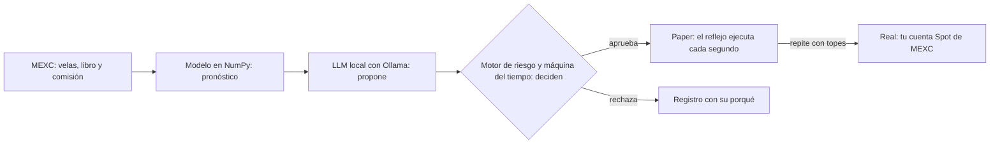

# Astrolabio

Agente de IA que opera solo una cartera de 40 activos de MEXC: 32 criptomonedas y 8 tokens que siguen acciones, divisas y oro. Revisa cada segundo sus condiciones de compra y venta y decide sin que nadie le diga qué hacer. Tiene dos carteras: **Paper**, con 50,000 USDT virtuales y precios reales de MEXC, y **Real**, que repite en tu cuenta Spot de MEXC lo que Paper ejecuta, dentro de topes en USDT. La Real arranca apagada y solo se enciende escribiendo la confirmación en el panel.

En ejecución no usa Claude ni Codex ni ningún servicio de pago: solo el modelo en NumPy, Ollama local y reglas deterministas. Corre en la laptop, así que no opera mientras esté apagada.

> **El mercado cayó 15.1 %. Astrolabio, 0.47 %.** Del 4 al 26 de noviembre de 2026, con 50,000 USDT virtuales y precios reales de MEXC, la cartera Paper terminó en 49,765.88 USDT mientras comprar y mantener sus mismos 40 activos perdía 15.1 %. Su peor caída fue de 0.48 %; la de la canasta, de 17.1 %. *Observado en Paper; no promete resultados futuros.*

| En números | |
| --- | --- |
| Activos vigilados cada segundo | 40, con 23,388 barridos del radar desde su último arranque |
| Latencia del reflejo | 2.4 ms de media para revisar los 40 activos |
| Futuros simulados antes de cada compra | 10,000, con la máquina del tiempo |
| Propuestas del LLM rechazadas por el motor de riesgo | 62, en vivo |
| Decisiones y órdenes registradas | 77,649 y 8,588, en vivo y en replays |
| Modelos entrenados en una GPU Tesla T4 | 2: BTC (682 s) y la cartera (258 s) |
| Pruebas automáticas | 707: 650 de Python y 57 del panel |



**Lo que lo hace único:**
- **Máquina del tiempo.** Antes de cada compra simula 10,000 futuros de 60 días con la historia reciente del activo; si en promedio pierde, no compra. En el replay de la cartera en VA bajó la caída máxima de 4.68 % a 2.45 % (simulado).
- **El riesgo decide.** El LLM solo propone. Reglas fijas aprueban o rechazan: 62 rechazos en vivo.
- **Reflejo de un segundo.** Stops, objetivos y compras armadas se revisan con el libro de órdenes en vivo.
- **Una prueba final, una vez.** La TE de BTC se abrió una sola vez, y ningún cambio entra sin una regla escrita antes: la cartera entrenada en T4 no se activó porque su resultado fue mixto.

## Estado al 2026-11-27

- **Modelo de BTC:** se entrenó en una GPU Tesla T4 de Colab (682 s, sin errores) y abrió TE una sola vez. BTC opera con ese modelo, `t4-2026-11-12`.
- **Modelo de la cartera en T4:** el 2026-11-27 el modelo conjunto de los otros 39 activos también se entrenó en una Tesla T4 (258 s, mismos cortes de fecha, TE sin abrir). En el replay de la cartera en VA ganó más (+1.54 % frente a +1.28 %) pero con más caída (2.70 % frente a 1.69 %): resultado mixto, así que sigue activo el modelo de CPU y el de T4 queda como evidencia en `models/t4-cartera-2025-09-17-40` (simulado).
- **Comparación final en TE** (BTC, 60 días, simulado): regla sin LLM −0.61 %, con LLM −3.13 %, comprar y mantener −3.13 %. Corrió con la configuración de ese momento, antes de la meta de 13 % y del filtro SMA20: la configuración de hoy no tiene validación en TE, solo simulación en VA y evidencia prospectiva en Paper.
- **Meta por operación:** cada compra pone su venta a +13 % más la comisión del par. Es un precio objetivo, no un 13 % neto asegurado: muchas operaciones cierran antes en el stop.
- **Cartera:** 32 criptomonedas y 8 tokens de acciones, divisas y oro. DASH, XMR y BDX salieron porque MEXC los retiró; RUNE entró en lugar de XMR y WLD en lugar de BDX, con la misma regla.
- **Paper en vivo** (observado, del 4 al 26 de noviembre): 28 órdenes ejecutadas y 6 compras que vencieron sin precio; 14 operaciones cerradas, 1 con ganancia, con resultado neto de −248.26 USDT; patrimonio de los 40 activos actuales en 49,765.88 USDT (−0.47 %), mientras la canasta de esos activos cayó 15.1 %.
- **Cartera Real:** lista desde el 2026-11-26, con saldo en la cuenta Spot. La clave pasó la prueba de MEXC para operar Spot con una orden de prueba que nunca se ejecuta. El 2026-11-27 se encendió unos minutos para capturar la vista y se apagó; no envió ninguna orden real porque Paper no tenía compras armadas.

## Versiones y avances

| Versión | Fecha | Avances |
| --- | --- | --- |
| 1.1 | 2026-11-27 | Modelo de la cartera entrenado en una GPU Tesla T4 con su propio notebook; queda como evidencia porque su replay en VA fue mixto. Vista Real con el circuito de la orden (Paper → topes → MEXC Spot), las compras que alcanza el saldo y el resultado de la prueba de la clave junto a su botón. `replay.py --modelo-cartera` compara modelos sin tocar el activo. |
| 1.0 | 2026-11-26 | Cartera Real: repite en la cuenta Spot de MEXC lo que Paper ejecuta, con topes en USDT, modo sombra y confirmación escrita. Selector Paper / Real en la cabecera y vista Real con el mismo tablero que Paper: saldo de MEXC, activos de la cuenta y órdenes reales. |
| 0.9 | 2026-11-26 | Despertador antes del cierre diario. WLD entra en lugar de BDX. Auditoría de diseño: un control por dimensión en Mercado, fechas ISO, horas en 24 h y errores en español. |
| 0.8 | 2026-11-21 | Métricas de riesgo (Sharpe, Sortino, VaR y CVaR), RSI y Bollinger alineados con su definición, y modelos de investigación en CPU: redes recurrentes, autoencoders, generativos y Double DQN. |
| 0.7 | 2026-11-19 | RUNE entra en lugar de XMR. Repositorio público con historial limpio y escaneo de secretos antes de cada `git push`. |
| 0.6 | 2026-11-13 | Modelo entrenado en GPU Tesla T4 activo para BTC. Acciones, divisas y oro en la cartera. Meta de +13 % más la comisión del par. Filtro SMA20 mínimo. Par retirado por MEXC: pausa sin reintentos. |
| 0.5 | 2026-11-12 | Rediseño del panel como terminal financiera. Máquina del tiempo antes de comprar. Todas las salidas recorren el libro de órdenes. |
| 0.4 | 2026-11-08 | Métricas de operaciones cerradas, historial de compras en alta o en baja y horas locales en el panel. |
| 0.3 | 2026-11-06 | Cuenta MEXC en solo lectura, comisión real por par en la simulación y orden que espera en el libro. |
| 0.2 | 2026-11-05 | Cartera de 40 activos con cupos iguales, reflejo cada segundo, observatorio de calidad, contraseña del panel y arranque automático. |
| 0.1 | 2026-11-04 | Agente Paper de BTCUSDT: ingesta pública de MEXC con auditoría, modelo en NumPy igual a Keras, motor de riesgo determinista, Ollama local con gateway privado y panel en React. |

Tecnologías y versiones:

| Pieza | Versión |
| --- | --- |
| Python | 3.13.15 |
| FastAPI y Uvicorn | 0.162.0 y 0.54.0 |
| NumPy, pandas y httpx | 2.5.4, 2.3.3 y 0.28.1 |
| PyTorch, Keras y scikit-learn (investigación) | 2.12.1+cpu, 3.15.1 y 1.9.1 |
| TensorFlow y Keras en Colab T4 (modelos de BTC y de la cartera) | 2.21.0 y 3.13.2 |
| Ollama y modelo local | 0.40.16, `qwen3:4b-instruct` |
| React, TypeScript y Vite | 19.3.1, 5.9.3 y 7.3.7 |
| Node | 24.21.0 |
| Pruebas | pytest 9.2.0 y Vitest 4.1.12 |

## Abrir

Doble clic en **Astrolabio**, el acceso del escritorio. Arranca el servidor en segundo plano y abre el panel en su propia ventana. Cerrar la ventana no apaga el bot, para que siga vigilando: se apaga en la pestaña Sistema, con **Apagar Astrolabio**.

La primera vez, o en otra computadora, usa **Iniciar Bot.cmd**: prepara lo que falte y crea `.env` con claves aleatorias. La primera clave del panel es `BOT_ADMIN_KEY`. Después puedes poner una contraseña tuya en la pestaña Sistema, sección Tu contraseña: se guarda solo su huella scrypt en la base local y la clave de `.env` sigue sirviendo para recuperar el acceso. Las sesiones duran 8 horas y sobreviven a los reinicios del bot: la base guarda solo la huella SHA-256 de cada sesión y su vencimiento, nunca la sesión misma, y cerrar sesión la borra. Para recrear el acceso:

```bash
powershell -ExecutionPolicy Bypass -File scripts\crear_acceso.ps1
```

Mientras la laptop está suspendida, Astrolabio no corre, y al despertarla no vuelve solo. Para que arranque en segundo plano, sin abrir ventana, cada vez que inicias sesión o desbloqueas la laptop, y para que Windows la despierte a las 23:50 UTC, diez minutos antes del cierre de la vela diaria, si está suspendida y conectada a la corriente:

```bash
powershell -ExecutionPolicy Bypass -File scripts\inicio_automatico.ps1
```

Crea la tarea «Astrolabio» del Programador de tareas, solo para tu usuario; si el bot ya corre, no hace nada. Con batería Windows no despierta el equipo, y apagado del todo nada puede correr: para no perder el ciclo, déjala suspendida y conectada, no apagada. Para quitar la tarea, el mismo comando con `-Quitar`.

Windows suspende esta laptop tras 1 hora sin uso, y suspendida no corre el ciclo diario. Para evitarlo mientras el bot corre, agrega `BOT_SIN_SUSPENDER=1` a `.env` y vuelve a abrir Astrolabio. La pantalla sí se apaga, gasta más batería y con la tapa cerrada Windows puede suspender igual. No cambia ningún ajuste de energía: al apagar Astrolabio, Windows lo olvida.

Requisitos: Python 3.13, Node 20 o posterior y [Ollama](https://ollama.com/download/windows) abierto con el modelo:

```bash
ollama pull qwen3:4b-instruct
```

Manualmente:

```bash
py -3.13 -m venv .venv
```

```bash
.venv\Scripts\python -m pip install -r requirements.txt
```

```bash
.venv\Scripts\python -m bot.preparar
```

```bash
cd frontend && npm install && npm run build
```

```bash
.venv\Scripts\python -m bot
```

El servidor registra sus mensajes en `data/servidor.log`. El panel queda en http://127.0.0.1:8770. La documentación de la API está en la pestaña Sistema, sección API documentada, y el esquema OpenAPI completo en `/api/openapi.json`; las dos piden sesión.

## Cartera Real: tu cuenta Spot de MEXC

La cartera Real repite con dinero real las compras y ventas que Paper ejecuta. Cuando Paper vende por stop, objetivo o stop móvil, la Real vende lo que compró. Se maneja en el panel, con el selector **PAPER / REAL** de la cabecera. La vista Real usa el mismo tablero que Paper: arriba el saldo de tu cuenta Spot, lo invertido por el bot, el resultado del día, el máximo por orden y el estado de la clave. En medio, un circuito muestra el camino de cada orden (Paper ejecuta → topes → MEXC Spot) y cuántas compras alcanza tu saldo; con la cartera encendida, el enlace se ilumina. Abajo, los activos de la cuenta y las órdenes reales.

1. En MEXC, en API Management, crea una clave con **View Account Details**, **View Order Details** y **Trade** de Spot. Nunca Withdraw ni Transfer. Si puedes, lígala a tu IP.
2. Copia la Access Key y la Secret Key en `.env`, en `MEXC_API_KEY=` y `MEXC_API_SECRET=`. No las pegues en el chat ni en otro archivo.
3. Reinicia el bot y abre **REAL**. **Probar la clave** pide a MEXC validar una orden de prueba que nunca se ejecuta.
4. Pon USDT en tu cuenta **Spot**. El bot solo usa ese saldo y nunca retira.
5. Elige un modo:
    - **Apagada:** no envía nada.
    - **Sombra:** arma cada orden y MEXC la valida con `/api/v3/order/test`, sin ejecutarla.
    - **Real:** envía las órdenes. Pide escribir `ACTIVAR REAL`.

Al encenderla solo repite lo que Paper ejecute desde ese momento. Cada compra va a mercado por hasta `max_orden_usdt`, mientras lo invertido no pase de `tope_total_usdt`; si el resultado del día llega a `−perdida_diaria_usdt`, no compra más ese día. Los topes por omisión son 50, 10 y 5 USDT; se cambian en `config/real.json`:

```json
{"tope_total_usdt": 50, "max_orden_usdt": 10, "perdida_diaria_usdt": 5}
```

Cada orden lleva un id de cliente `astro<id de la orden Paper>`. Si se pierde la respuesta de MEXC, el bot la consulta por ese id antes de hacer nada más, así no la duplica. Si MEXC rechaza una orden, las compras quedan en pausa y las ventas siguen. Todo queda en la tabla de órdenes reales del panel.

Sin IP ligada, MEXC vence la clave a los 90 días; se renueva desde la misma página.

Con la clave conectada, `.venv/Scripts/python scripts/comisiones_mexc.py` guarda en `config/comisiones.json` la comisión real de cada par para tu cuenta; reinicia el bot para que la simulación la cobre. Un par sin dato usa la comisión general de Sistema.

## Cómo decide

Tiene dos velocidades: un cerebro lento y un reflejo rápido.

**Cerebro, una vez al día por activo.** Cada 30 segundos revisa si cerró una vela diaria (00:00 UTC, 18:00 en Ciudad de México). Con cada vela nueva, una sola vez:

1. Lee velas cerradas de MEXC y valida activo, orden, huecos y antigüedad.
2. Calcula variables con la misma definición del entrenamiento y pronostica el rendimiento del día siguiente.
3. Pide a Ollama una propuesta en JSON: comprar, mantener o vender. El LLM recibe datos y herramientas de solo lectura. Con 40 activos toma unos 5 minutos, uno a la vez.
4. Valida la propuesta y aplica el motor de riesgo. El LLM no puede abrir posición sin señal del modelo ni cambiar límites.
   **Máquina del tiempo** (encendida, se cambia en Sistema): antes de autorizar una compra repite 10,000 veces los próximos 60 días con las últimas 60 velas del activo y sus mismas salidas; si en promedio pierde, no la autoriza. Idea de day-trader-skill. En el replay de la cartera en VA subió el rendimiento de +2.57 % a +2.95 % y bajó la caída máxima de 4.68 % a 2.45 % (simulado).
   **Tope de compras por día** (apagado, `max_compras_dia` = 0): la cartera no autoriza más compras nuevas por vela diaria que ese número. 0 es sin tope.
   **Punto de equilibrio** (apagado, `proteger_atr` = 0): al ganar esa cantidad de ATR, el stop sube a la entrada más costos. En VA, a 1 ATR dio +2.78 % contra +2.95 % sin él, así que quedó apagado (simulado).
   **Filtro técnico mínimo** (encendido desde el 2026-11-13, `filtro_minimo` = `sma20`): si la regla elegida en VA no trae filtro, como pasa con los dos modelos de hoy, la compra exige además que el precio esté sobre su SMA20. El reflejo lo revisa cada segundo y el Radar muestra el precio, la SMA20 y la distancia. Con `""` vuelve la regla tal como salió de VA.
5. Si la aprueba, **arma** la compra para ese día. Guarda la decisión en una sola transacción de SQLite.

**Reflejo, cada segundo.** Una sola consulta trae la mejor compra y venta de todos los pares. Para cada activo:

- **Con posición:** revisa stop, objetivo y stop móvil. El stop y el stop móvil venden al instante; el objetivo es una venta que espera en el libro a su precio, sin comisión.
- **Con compra armada:** revisa 5 condiciones: señal del día, filtro técnico en vivo, spread y libro, no perseguir el precio y riesgo. Con las 5 cumplidas deja una orden que espera al mejor precio de compra; se llena solo si el precio de venta baja hasta ella, y entonces paga 0 % de comisión. Si deja de cumplirse una condición, se cancela. Si a los 30 minutos no se llenó y todo sigue en orden, compra al instante al precio medio del libro visible, con la comisión real del par. Detalle en `docs/ORDEN_EN_ESPERA.md`.
- **Sin precio fresco:** no opera.
- **Compra autorizada que no se ejecutó:** al terminar el día queda como orden expirada con las condiciones que faltaron. Es la evidencia para ajustar las reglas en vivo.

**Cartera.** 50,000 virtuales repartidos en cupos iguales: cada activo tiene su cuenta y su corrida. El fallo de un activo no detiene a los demás. La pestaña **Radar** muestra todo en vivo.

Si falla MEXC u Ollama, no abre posiciones, lo registra y reintenta solo; los stops siguen protegiendo. Una clave incorrecta o un límite de caída alcanzado requieren intervención humana. Si MEXC deja de listar un par, su agente queda en pausa con ese motivo y no reintenta: sacarlo de `config/universo.json` es decisión humana. Se agregó después de que MEXC retirara DASHUSDT el 2026-11-13.

**Desactivar bot**, en la cabecera de cualquier vista, bloquea toda orden nueva y conserva las posiciones; antes de hacerlo avisa cuántas quedan abiertas. **Cerrar todas** es una acción aparte, en «Acciones avanzadas». Al reiniciar se recupera el estado sin duplicar operaciones; las velas perdidas solo revisan stops con su máximo y mínimo.

Supuestos del simulador, en `config/riesgo.json`: capital de 50,000, comisión real de MEXC por par para la cuenta conectada (`config/comisiones.json`: 0.05 % en 29 pares, 0.08 % en 9 y 0 % en XRP y el euro; 0.08 % si falta el dato) y 0 % para la orden que espera, precio medio de recorrer el libro visible en vivo más 5 puntos base de deslizamiento en lo que se compra o vende al instante, exposición máxima de 80% por cupo, riesgo de 2% por operación, stop a 2 ATR, objetivo de venta a +13 % más la comisión del par (la meta por operación, `objetivo_pct`; con 0 vuelve a 4 ATR), stop móvil a 2 ATR, pérdida diaria de 5%, caída máxima de 25%, dato de hasta 26 horas, spread de hasta 25 puntos base y precio de hasta 5 segundos.

**Consumo de internet:** revisar cada segundo descarga unos 50 KB por segundo, alrededor de 4.3 GB al día. Con datos móviles conviene espaciarlo con `BOT_REFLEJO_S` en `.env`.

## Activos y modelos

`config/universo.json` guarda los 40 activos y cómo se eligieron, sin mirar resultados del modelo. Las criptomonedas se eligieron el 2026-11-05: spot contra USDT, por volumen de 24 horas, sin estables, envueltos, metales, acciones tokenizadas ni apalancados, con al menos 900 días y spread mediano de hasta 25 puntos base. Elegir por el volumen de hoy favorece a los sobrevivientes: cualquier evaluación del pasado sale optimista.

```bash
.venv\Scripts\python scripts\elegir_universo.py
```

**Pares que MEXC retiró.** DASH salió el 2026-11-13. XMR salió el 2026-11-19: desde el 17, MEXC responde «Invalid symbol» y su agente quedaba en pausa. XMR nunca operó, así que en su lugar entró la cripto de mayor volumen de 24 h que cumple la misma regla y que no estaba ni había salido: RUNEUSDT (THORChain), con 1,029 días seguidos, spread mediano de 22.5 pb y comisión de 0.05 %. BDX salió el 2026-11-26 (UTC): desde el 23, MEXC también responde «Invalid symbol». Tampoco operó nunca, y con la misma regla entró WLDUSDT (Worldcoin), con 1,221 días seguidos, spread mediano de 4.1 pb y comisión de 0.05 %. La regla se fijó antes de medir. La cartera sigue en 40 activos de 1,250 USDT, así que el patrimonio total no cambia. El detalle está en «cambios» de `config/universo.json`.

### Acciones, divisas y oro (desde el 2026-11-13)

La cartera no es solo de criptomonedas. MEXC no vende acciones ni divisas, pero sí tokens que siguen su precio y se compran con USDT. Ocho de los 40 activos son de este tipo:

| Par | Qué es | Historia en MEXC | Comisión | Spread fuera / con la bolsa abierta |
| --- | --- | --- | --- | --- |
| `GOLD(XAUT)USDT` | Tether Gold: sigue el precio del oro | 1,296 días, desde 2023-04-27 | 0.05 % | 0.1 / 0.0 pb |
| `EURUSDT` | Euro contra dólar | 625 días, desde 2025-02-26 | 0 % | 0.9 / 0.9 pb |
| `BRLUSDT` | Real brasileño contra dólar | 606 días, desde 2025-03-17 | 0.08 % | 11.4 / 5.7 pb |
| `SPYONUSDT` | ETF SPDR S&P 500 (500 empresas grandes de EE. UU.), de Ondo | 430 días, desde 2025-09-09 | 0.08 % | 8.4 / 17.7 pb |
| `QQQONUSDT` | ETF Invesco QQQ (índice Nasdaq-100), de Ondo | 430 días, desde 2025-09-09 | 0.08 % | 8.7 / 18.8 pb |
| `AAPLXUSDT` | Acción de Apple, xStock de Backed | 499 días, desde 2025-07-02 | 0.08 % | 2.0 / 3.5 pb |
| `METAXUSDT` | Acción de Meta, xStock de Backed | 498 días, desde 2025-07-03 | 0.08 % | 1.6 / 6.6 pb |
| `MSFTONUSDT` | Acción de Microsoft, de Ondo | 431 días, desde 2025-09-08 | 0.08 % | 8.8 / 18.0 pb |

Spread medido el 2026-11-13 a las 13:59 y a las 18:03 UTC, en 6 y 10 lecturas del libro. Comisión real de la cuenta conectada al comprar al instante (`config/comisiones.json`).

- **xStocks (terminan en X):** los emite Backed en la red Solana. Cada token dice estar respaldado por una acción real que guarda un custodio, y los dividendos se reinvierten en el token.
- **Ondo Global Markets (terminan en ON):** los emite Ondo Finance en Ethereum, con el mismo esquema: una acción o un ETF real detrás de cada token. Un ETF como SPY reúne 500 empresas, así que diversifica más que una sola acción.
- **Oro:** cada token XAUT, de Tether, dice equivaler a una onza troy de oro físico guardado en Suiza.
- **Divisas:** el euro y el real son saldos dentro de MEXC, sin contrato en blockchain. Se compran con USDT, que vale cerca de un dólar, así que su precio es el tipo de cambio.
- **Operan las 24 horas, todos los días, aunque su mercado cierre.** La bolsa de Nueva York abre de lunes a viernes de 9:30 a 16:00 (hora de Nueva York), y las divisas y el oro casi no cotizan el fin de semana. Fuera de ese horario MEXC sigue cotizando el token con menos volumen: el precio puede separarse del real y saltar en la apertura. En los últimos 400 días, el movimiento medio de un sábado o domingo fue de 30 % a 65 % del de un día hábil (observado en el oro, el euro, el real, SPY y Apple).
- **El bot no los trata distinto:** mismas reglas, mismo cupo y mismos controles. El spread máximo de 25 pb y la revisión del libro frenan las compras cuando hay poca liquidez, pero un stop puede activarse en fin de semana con un precio que no es el de la bolsa.

**Cómo se eligieron.** La regla se fijó antes de medir con la bolsa abierta y antes del replay:
- Pares en USDT que MEXC deja operar y que siguen acciones, ETF, divisas u oro.
- Spread mediano de hasta 25 pb y un libro que cubre 1,000 USDT moviendo el precio 25 pb o menos, fuera y dentro del horario de la bolsa. Mil USDT es lo máximo que el bot compra con un cupo.
- Al menos 120 velas diarias seguidas. Un token por subyacente: el de menor spread con la bolsa abierta.
- Un oro y dos divisas por volumen de 24 h, los ETF del S&P 500 y del Nasdaq-100, y tres de las siete grandes de EE. UU. (Apple, Microsoft, Nvidia, Amazon, Alphabet, Meta y Tesla) por menor spread con la bolsa abierta. Nvidia, Amazon y Tesla pasaron con spreads mayores; Alphabet no pasó.
- El peso mexicano no pasó: comprar 1,000 USDT movería su precio más de 1 %.

**Qué salió.** Salieron ZIG, ARB, XLM, GRAM, LINK, QNT y BONK: las criptos de menor volumen de 24 h que nunca operaron en Paper. Las que tienen posición o historial se quedan, así el patrimonio total no cambia. DASH ya había salido porque MEXC lo retiró. La cartera sigue en 40 activos y cada uno en 1,250 USDT.

**Sin validación propia.** El modelo de la cartera se entrenó y se validó solo con criptomonedas: nunca vio una acción, una divisa ni el oro. Los acepta sin errores porque sus variables son relativas (rendimiento, distancia a la SMA20 y volatilidad de 20 días). En su última ventana quedan a menos de 1.3 desviaciones de lo que vio, del lado de la volatilidad baja, como BTC en días tranquilos. Se operan en Paper como extensión, sin validación propia.

**Casi nunca se compran.** Dos filtros los frenan:
- **El umbral del modelo:** pide un pronóstico de +0.4 % para el día siguiente, pensado para la volatilidad de las criptos. En VA el pronóstico más alto del oro fue +0.38 %.
- **La máquina del tiempo:** con la meta de +13 %, el euro, el real y el oro llegan al objetivo en 0 a 1 % de sus repasos de 60 días, así que no se autorizan (observado el 2026-11-13). Las acciones se mueven más: Apple, Meta y Microsoft sí pasaron el repaso ese día.

Con el modelo actual funcionan casi siempre como efectivo.

**En VA no hicieron ninguna operación** (simulado, solo como referencia). Es el replay de la cartera del 2024-08-02 al 2025-09-16, con la regla sin LLM, la máquina del tiempo y la meta de +13 %:

| Cartera | Rendimiento | Caída máxima | Operaciones | Ganadoras |
| --- | --- | --- | --- | --- |
| 39 criptos (antes) | +2.57 % | 2.48 % | 915 | 54 % |
| 32 criptos y 8 nuevos (ahora) | +1.44 % | 2.17 % | 743 | 53 % |

- **Por qué no operaron:** los tokens de Ondo empezaron a cotizar después de VA, y los demás nunca pasaron el umbral.
- **De dónde sale la diferencia:** de las 7 criptos que salieron, que en VA ganaron 547 USDT. El efectivo baja la caída, pero también el rendimiento.
- **Qué no prueba:** no es una validación, porque hay muy pocos datos de estos activos en VA. La regla de elección se fijó antes de ver este resultado.

```bash
.venv\Scripts\python scripts\agregar_activos.py --agregar "GOLD(XAUT)USDT" EURUSDT --quitar ZIGUSDT --motivo "por qué"
```

El script descarga y audita las velas diarias de cada activo nuevo (al menos 120 seguidas, las que usa el bot), las guarda en `data/cartera/` y anota el cambio con su fecha y motivo en `config/universo.json`. Después hay que correr `scripts\comisiones_mexc.py`, reiniciar el bot y pulsar «Activar bot» en el panel: los activos nuevos arrancan detenidos.

BTC usa el modelo de `models/ACTIVO.txt`, entrenado en la T4. Los otros 39 usan el modelo conjunto de `models/CARTERA.txt`, entrenado con todos los activos y evaluado por activo en validación:

```bash
.venv\Scripts\python research\entrenar_cartera.py
```

Un activo sin modelo aprobado queda fuera de la cartera y el panel lo avisa. El de BTC, `t4-2026-11-12`, se entrenó en la T4 de Colab. El de la cartera activo es de desarrollo, entrenado en CPU; su versión entrenada en T4, `t4-cartera-2025-09-17-40`, queda como evidencia (ver «La cartera en T4»).

**Indicadores** (`bot/features.py`, los mismos al entrenar y en vivo; cada uno usa solo historia hasta el cierre):
- Distancias del cierre a su SMA20 y a su EMA20.
- Posición en las bandas de Bollinger, con dos desviaciones poblacionales (ddof = 0) de 20 cierres.
- RSI de Wilder, que arranca con la media de los primeros 14 cambios.
- Histograma del MACD 12/26/9 dividido entre el cierre, para comparar activos con precios distintos.
- ATR14, volatilidad de 20 rendimientos y volumen relativo.

El modelo de BTC usa solo rendimientos. El de la cartera usa rendimientos, distancia a la SMA20 y volatilidad. Los demás indicadores alimentan al LLM, al Radar y a los modelos de investigación.

**Métricas de riesgo** (`bot/metricas_riesgo.py`): volatilidad anual, Sharpe y Sortino se anualizan con 365 días, porque MEXC cotiza todos los días, y usan una tasa libre de riesgo y una meta de 0 %. VaR y CVaR son históricos, a un día y al 95 %. El CVaR promedia la cola con peso fraccionario en la última observación. Aparecen en la tabla de corridas de la pestaña Resumen y en cada simulación del laboratorio.

## Entrenamiento en GPU (Colab T4)

**Hecho el 2026-11-13:** el notebook corrió una sola vez en una Tesla T4 y abrió TE una sola vez (`apertura_te.json`: 1 apertura, sin contaminar). No lo vuelvas a correr: sería una segunda apertura de TE. Los pasos quedan como referencia:

1. En Google Colab, *Archivo > Subir notebook* y elige `notebooks/Astrolabio_Modelo_BTC.ipynb`. Ya pide GPU T4.
2. *Ejecutar todo*. Si no hay T4, se detiene antes de entrenar.
3. Si Colab no puede descargar de MEXC, se detiene antes de entrenar y sin abrir TE. Sube `data/raw/BTCUSDT_1d.csv` en el panel *Archivos* con el nombre `BTCUSDT_1d.csv` y vuelve a *Ejecutar todo*. Ese archivo llega a la vela del 2026-11-04.
4. Descarga `resultados_t4.zip`: trae `experimentos.csv`, `predicciones_TE.csv`, `prediccion_futura.csv`, `simulacion.csv`, datos, bitácora, evidencia de T4 y la carpeta del modelo.
5. Copia la carpeta `t4-AAAA-MM-DD` a `models/` y escribe su nombre en `models/ACTIVO.txt`. Reinicia el bot: pestaña Sistema, **Apagar Astrolabio**, y ábrelo otra vez con el acceso del escritorio.

**TE se abre una sola vez.** Si reejecutas y cambia algo, el notebook lo declara contaminado.

`models/dev-cpu-*` se entrenó en CPU para integrar el sistema: es de desarrollo. El modelo final de BTC es `t4-2026-11-12`.

### La cartera en T4

**Hecho el 2026-11-27:** `notebooks/Astrolabio_Modelo_Cartera.ipynb` entrenó el modelo conjunto de la cartera en una Tesla T4 en 258 s. Sigue el protocolo de `research\entrenar_cartera.py`, con el código común en `research/cartera.py`: mismas variables, redes e hiperparámetros, regla elegida con VA simulando la cartera completa y los mismos cortes de fecha que el modelo activo. **No abre TE.**

1. En Colab, *Archivo > Subir notebook* y elige `notebooks/Astrolabio_Modelo_Cartera.ipynb`. Ya pide GPU T4 y se detiene si no la hay.
2. *Ejecutar todo*. Baja `data/cartera/` y `config/universo.json` de este repositorio, fijados a un commit, así que entrena exactamente con los datos del proyecto.
3. Descarga `resultados_cartera_t4.zip` y copia su carpeta `t4-cartera-…` a `models/`.
4. Compara antes de activarlo, con la misma configuración:

```bash
.venv\Scripts\python research\replay.py --decisor regla --cartera --dias 5000
.venv\Scripts\python research\replay.py --decisor regla --cartera --dias 5000 --modelo-cartera t4-cartera-2025-09-17-40
```

Solo se escribe en `models/CARTERA.txt` si sube el rendimiento sin subir la caída máxima, o baja la caída sin bajar el rendimiento. Resultado del 2026-11-27, en VA del 2024-08-02 al 2025-09-16 (simulado):

| Modelo de la cartera | Rendimiento | Caída máxima | Operaciones | Sharpe |
| --- | --- | --- | --- | --- |
| Activo, en CPU | +1.28 % | 1.69 % | 509 | 0.55 |
| T4 | +1.54 % | 2.70 % | 873 | 0.46 |

Rindió más, pero con más caída: es mixto, así que no se activó.

`research\construir_notebook_cartera.py` regenera el notebook. Para probarlo sin GPU, con cuatro activos y dos épocas: `NB_PRUEBA=1` y `NB_DATOS` con la carpeta del proyecto.

Si cambias el entrenamiento, regenera el notebook con `research\construir_notebook.py`: copia los módulos de `bot/` y `research/` para que el notebook y el agente usen el mismo código. `research\probar_notebook.py` lo ejecuta completo con datos sintéticos y sin GPU, sin abrir el TE real. En esta laptop, Control de aplicaciones bloquea un binario de scikit-learn 1.9.1 y la prueba se detiene en el diagnóstico de sesgo y varianza, después de la celda de TE sintético; en Colab no pasa.

## Modelos de investigación (CPU)

`research/modelos_avanzados.py` entrena en CPU, con PyTorch, cuatro familias de modelos sobre BTC diario con las mismas 9 variables: el rendimiento y los ocho indicadores.
- **TE nunca se usa:** la tabla se corta en el último objetivo de VA.
- **VA se parte en dos:** del 2024-08-07 al 2025-02-28 se eligen épocas, arquitecturas y el mejor punto de control; del 2025-03-01 al 2025-09-23, 207 días, solo se mide.
- **Dónde ver los resultados:** en `models/avanzados/resultados.json` y en la pestaña Estrategia.
- **No deciden operaciones:** son simulaciones; el bot sigue con el modelo entrenado en T4.

```bash
.venv\Scripts\python research\modelos_avanzados.py
```

**Pronóstico del rendimiento del día siguiente.** Cada modelo se mide en la mitad que solo mide (simulado). La regla compra si el pronóstico supera 0.05 %, con 0.10 % de costo por lado. Comprar y mantener dio +31.5 % en ese periodo.

| Modelo | RMSE | Dirección | Regla | Caída | Sharpe |
| --- | --- | --- | --- | --- | --- |
| Pronóstico cero | 0.02191 | sin dato | sin operaciones | 0 % | sin dato |
| Ridge α=1000, solo rezagos | 0.02168 | 54.6 % | +59.4 % | 14.4 % | 2.65 |
| Ridge α=1000, 9 variables | 0.02173 | 52.2 % | +44.0 % | 9.5 % | 2.45 |
| LSTM | 0.02196 | 48.8 % | +24.2 % | 12.7 % | 1.69 |
| GRU | 0.02211 | 49.3 % | +18.3 % | 18.7 % | 1.01 |
| LSTM bidireccional (la elegida por validación) | 0.02209 | 51.7 % | +14.2 % | 13.2 % | 0.86 |
| MLP con Swish, AdamW y ReduceLROnPlateau | 0.02184 | 52.7 % | +17.1 % | 9.1 % | 1.13 |

Ninguna red recurrente supera al pronóstico cero en RMSE, y la MLP lo supera apenas. Ridge con solo rezagos es la configuración del modelo en producción. Se eligió con todo VA, esta mitad incluida, así que su cifra aquí no es independiente.

**Autoencoders.** Comprimen las 9 variables del día en 3 factores. El autoencoder con ruido (σ = 0.1), elegido por validación, reconstruye mejor que PCA: error de 0.057 contra 0.089. Sus factores no pronostican mejor: Ridge sobre ellos da un RMSE de 0.02190, igual que el pronóstico cero.

**Escenarios generados.** Un VAE y una GAN condicionales generan 16 días de rendimientos según la volatilidad de las 20 sesiones previas. La GAN se acerca más a las colas reales: CVaR al 95 % a 16 días de 10.1 % contra 8.9 % real. El VAE las subestima (2.4 %) y casi no reacciona a la volatilidad. Remuestrear días de entrenamiento las exagera (25.2 %), porque esos años fueron más volátiles.

**Agente Double DQN.** Decide al cierre entre efectivo y comprado; cada cambio paga 0.10 % en la apertura siguiente. No vende en corto, porque MEXC spot no lo permite.

| Política | Rendimiento | Caída | Sharpe | Días comprado |
| --- | --- | --- | --- | --- |
| Double DQN | +27.9 % | 12.2 % | 1.48 | 77 % |
| Siempre comprado | +31.5 % | 19.0 % | 1.36 | 100 % |
| Q-learning tabular | 0 % | 0 % | sin dato | 0 % |

La validación eligió el episodio 3 de 40, todavía con mucha exploración: su política se parece a quedarse comprado, y saliendo algunos días cae menos. El Q-learning tabular aprendió a no comprar nunca.

## Comparación con y sin LLM

Con el backend abierto, cada corrida queda en la pestaña Resumen, etiquetada como replay:

```bash
.venv\Scripts\python research\replay.py --decisor regla --dias 60
```

```bash
.venv\Scripts\python research\replay.py --decisor llm --dias 60
```

```bash
.venv\Scripts\python research\replay.py --decisor regla --cartera --dias 400
```

Por defecto usa validación. Para TE exige `--conjunto TE --confirmo-abrir-te`, solo con el modelo final. Esa corrida ya se hizo una vez, el 2026-11-13: no la repitas. El replay ejecuta en la apertura siguiente con velas diarias: no reproduce el reflejo por segundo, porque no hay historia de cada segundo. No cuenta como observaciones nuevas de la conexión actual.

## Pruebas

```bash
.venv\Scripts\python -m pip install -r requirements-research.txt
```

```bash
.venv\Scripts\python -m pip install torch==2.12.1+cpu --index-url https://download.pytorch.org/whl/cpu
```

```bash
.venv\Scripts\python -m pytest -q
```

```bash
cd frontend && npx vitest run
```

Nueve escenarios de error tienen pruebas automáticas:

| Error | Prueba |
| --- | --- |
| API sin respuesta o con límite | `test_api_sin_respuesta_o_con_limite_pausa_registra_y_no_opera` |
| Dato atrasado | `test_dato_atrasado_pausa_y_no_opera` |
| Ollama detenido | `test_ollama_detenido_pausa_nuevas_decisiones_sin_operar_ni_consumir_la_vela` |
| JSON inválido | `test_json_invalido_no_opera` |
| Clave incorrecta | `test_clave_incorrecta_del_gateway_pausa_sin_reintento_automatico`, `test_gateway_rechaza_clave_ausente_o_incorrecta` |
| Saldo insuficiente | `test_saldo_insuficiente_rechaza_y_registra_sin_cambiar_la_cuenta` |
| Evento duplicado | `test_evento_duplicado_no_opera_dos_veces_la_misma_vela` |
| Reinicio del backend | `test_reinicio_del_backend_recupera_estado_sin_duplicar` |
| Botón de detención | `test_boton_detener_bloquea_ordenes_sin_liquidar_la_posicion` |

Hay días sin señal, y entonces no se ve ninguna compra en vivo. Para ver la cadena completa con precios reales, sin tocar el bot ni su base de datos, esta prueba fuerza el umbral en memoria durante 60 segundos. No es una señal real:

```bash
.venv\Scripts\python research\prueba_cadena.py 60
```

Para exportar los registros a CSV, aun con el bot encendido:

```bash
.venv\Scripts\python scripts\exportar_registros.py
```

## Seguridad

Las claves viven solo en `.env`, que git ignora; `.env.example` trae los nombres sin valores. La clave de MEXC lee la cuenta y opera Spot, nunca retira. Las órdenes reales solo salen de `bot/real.py`, detrás de la cartera Real, que arranca apagada y pide escribir la confirmación; el panel no tiene ruta para mandar una orden a mano ni para retirar. El panel escucha solo en esta laptop y guarda tu contraseña como huella scrypt y cada sesión como huella SHA-256. Antes de subir cambios a GitHub, este comando revisa todo el historial sin mostrar ningún valor; `git push` lo corre solo:

```bash
.venv\Scripts\python scripts\revisar_secretos.py
```

Qué se protege, qué hacer si una clave se filtra y cómo avisar de un problema: [SECURITY.md](SECURITY.md).

## Estructura

| Carpeta | Contenido |
| --- | --- |
| `bot/` | Cartera, reflejo, agente, riesgo, simulador, cartera Real, cliente de MEXC, gateway del LLM y API |
| `frontend/` | Panel en React y TypeScript |
| `research/` | Laboratorio, entrenamientos en CPU, replay y generadores de los notebooks |
| `notebooks/` | Entrenamiento para Colab con T4: el modelo de BTC y el de la cartera |
| `models/` | Modelos versionados con su contrato de variables |
| `data/` | Datos originales y procesados con su ficha de auditoría; `data/cartera/` tiene la historia diaria de los activos de la cartera |
| `docs/` | Documentación técnica: orden en espera, observatorio, estrategias intradía y logos de los activos |

## Análisis final

- **Lo que logró (observado).** En tres semanas de Paper en vivo, con un mercado que cayó 15.1 %, Astrolabio perdió 0.47 % y su peor caída fue de 0.48 %. Cerró 14 operaciones con 1 ganadora: la mayoría salió por stop, que es lo que protege el capital.
- **Lo que no logró.** Ningún modelo superó con claridad al pronóstico cero, ni en BTC ni en la cartera. La ventaja medible está en el riesgo (stops, máquina del tiempo y topes), no en adivinar el precio.
- **Disciplina.** La prueba final de BTC se abrió una sola vez. La cartera entrenada en T4 rindió más en VA, pero no se activó porque también cayó más: la regla escrita antes del replay manda. Cada resultado se declara como propuesto, simulado, observado o validado.
- **Ingeniería.** 707 pruebas automáticas, dos entrenamientos en GPU T4, un radar que barre 40 activos cada segundo con 2.4 ms de latencia y una cartera Real que repite en MEXC lo que Paper ejecuta, con topes y sin rutas de retiro.
- **Siguiente paso.** Probar la cartera Real en modo Sombra, juntar más velas en vivo antes de subir los topes y correr el bot en un equipo siempre encendido.

## Límites conocidos

- El rendimiento histórico no garantiza nada. El bot no promete ganancias ni da consejos de inversión.
- La cartera Real repite una estrategia que en Paper cerró 14 operaciones con 1 ganadora y −248.26 USDT: espera resultados parecidos y usa topes que puedas perder completos.
- La cartera Real no deja órdenes stop en MEXC: su stop es el de Paper y lo vigila el bot cada segundo. Con la laptop suspendida o apagada, una posición real queda sin stop.
- La meta por operación, desde el 2026-11-13, es 13 % en los pares sin comisión y 13 % más la comisión en los demás. El bot la usa como objetivo de venta de cada operación (XRP a +13 %, la mayoría a +13.05 %, los de 0.08 % a +13.08 %). Es el precio al que se pone la venta, no una ganancia neta asegurada: muchas operaciones cierran antes en el stop, y el resultado neto depende de comisiones y deslizamiento. Tampoco garantiza que la cartera gane 13 %, y los resultados actuales quedan lejos: VA +2.64 % con la meta y +2.87 % con el objetivo anterior en ATR (simulados), TE −0.61 % con la regla sin LLM (simulado, con la configuración anterior a la meta y al filtro SMA20) y Paper en vivo −0.45 % al 19 de noviembre (observado).
- El cerebro decide una vez al día: 20 días de decisiones en vivo tardan 20 días. Con 40 activos son 800 decisiones.
- Las reglas de entrada en vivo (spread, no perseguir, cruce de SMA20 durante el día) no se pueden validar con historia por segundo: solo el Paper en vivo dirá cómo se comportan.
- El modelo de BTC se entrenó y se evaluó en la T4. Los otros 39 activos usan un modelo conjunto de desarrollo, entrenado en CPU: su versión de T4 dio un resultado mixto en VA y no se activó.
- Las acciones, divisas y oro (8 de los 40, desde el 2026-11-13) se operan sin validación propia: el modelo de la cartera solo vio criptomonedas. Ver «Acciones, divisas y oro».
- Si MEXC limita las consultas, el reflejo las espacia y lo avisa; mientras no haya precio fresco no opera.
- Windows bloquea binarios recientes en esta laptop, así que `pandas` y `torch` quedan en versiones fijas.
